<p align="center">
  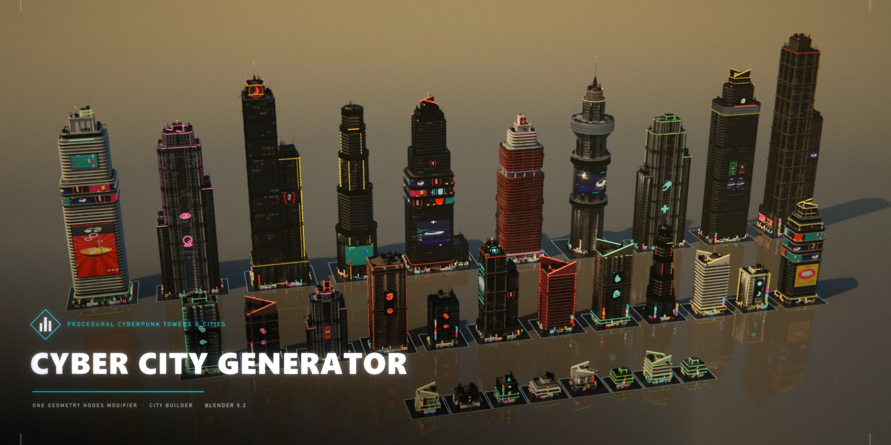
</p>

<h1 align="center">Cyber City Generator</h1>

<p align="center">
  <b>Procedural cyberpunk skyscrapers and entire neon cities for Blender.</b><br>
  One Geometry Nodes modifier per tower, or a whole city with one command.
</p>

<p align="center">
  
  
  
  
  
</p>

<p align="center">
  <a href="https://superhivemarket.com/products/cyber-city-generator"><b>Get it on Superhive</b></a>
  &nbsp;·&nbsp;
  <a href="https://www.youtube.com/watch?v=4zOTrarYtss"><b>Watch the trailer</b></a>
  &nbsp;·&nbsp;
  <a href="https://blenderprocedural.github.io/cyber-city-generator/"><b>Product page</b></a>
</p>

---

## One modifier, one tower

Add the **BT Tower Generator** modifier to any mesh and a complete tower builds itself live. It includes:

- the mass, setbacks and crown
- facade bays, frames and technical floors
- glass, metal and concrete with grime
- LED screens with animated ads, neon pictogram signs and lit rooms
- roof plant and street-level shops

Every input is a normal modifier field, so you can drag it, keyframe it or drive it.

<p align="center">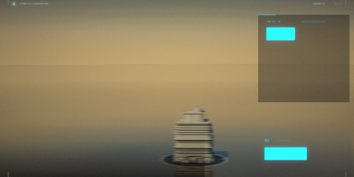</p>

## Endless variations

Separate seeds for **mass**, **facade**, **ads** and **lights**. Keep a silhouette you like and re-roll only
its lights or its screens. The same inputs always give the same building.

<p align="center">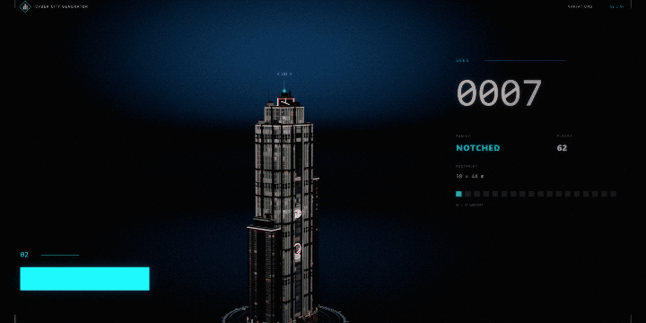</p>

## Six building families

| Family | Character |
|---|---|
| **Belt** | LED belts and an ad wall |
| **Terrace** | Cantilevered slabs with balconies |
| **Notched** | Recessed corners and vertical screens |
| **Blocks** | Towers rising from a shared podium |
| **Tech** | Cylinders, polygon tiers and spires |
| **Shophouse** | Low-rise street blocks |

<p align="center">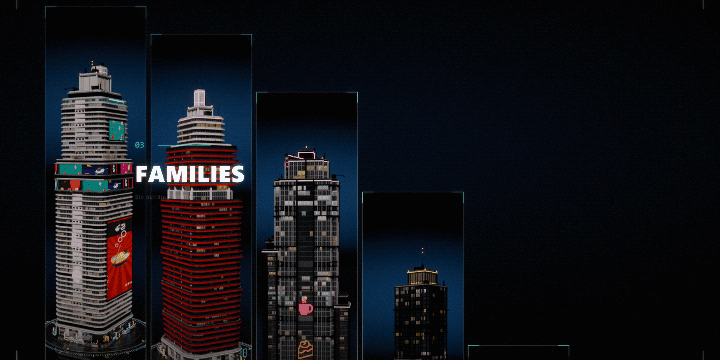</p>

## Day and night

Under a hazy afternoon sun the neon keeps burning. After dark the rooms light up floor by floor.

<p align="center">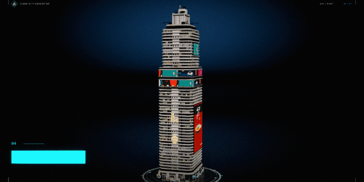</p>

## Whole cities

`build_city.py` places hundreds of towers on a street grid. Pick one of four layouts (grid, downtown, strip,
megablock) or set your own blocks, block size and street width. The builder adds:

- sidewalks, lamps and neon shop totems
- sign gantries with pictogram direction signs
- traffic lights, cables and bollards
- an elevated rail and skybridges
- a reflective bay, a lit far city and searchlights

Every building in the city stays a live modifier.

<p align="center">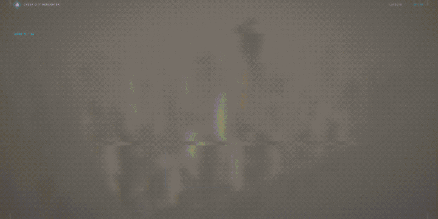</p>
<p align="center">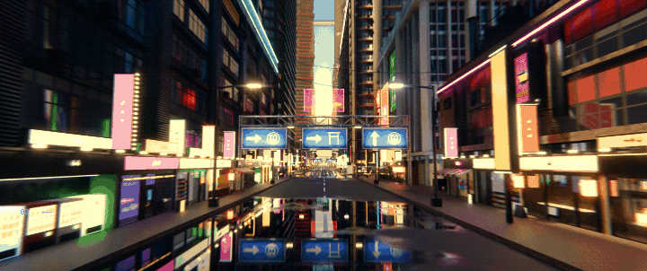</p>

## Gallery

| | |
|---|---|
| 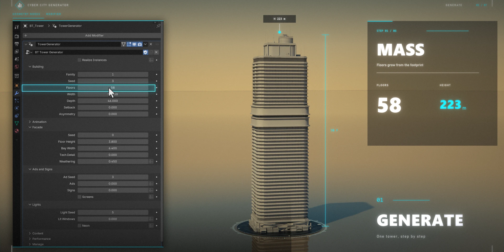 | 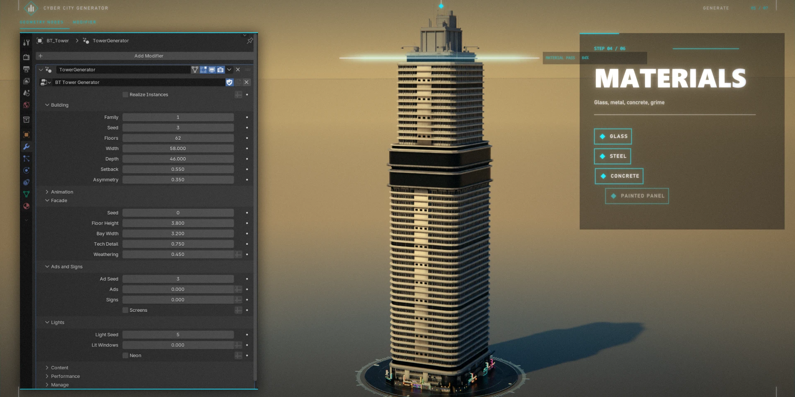 |
| 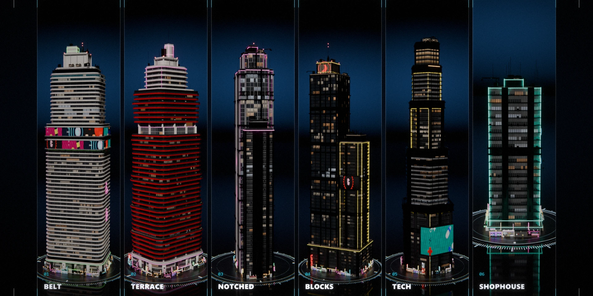 | 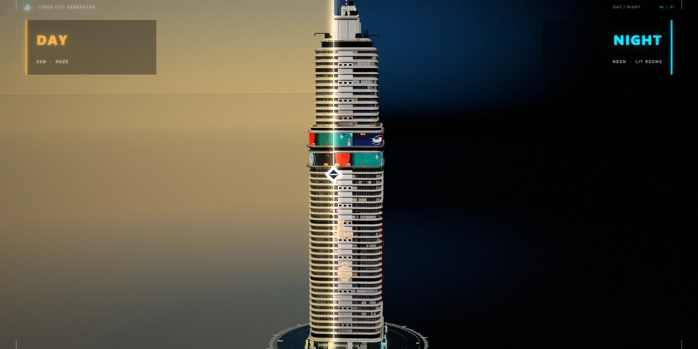 |
| 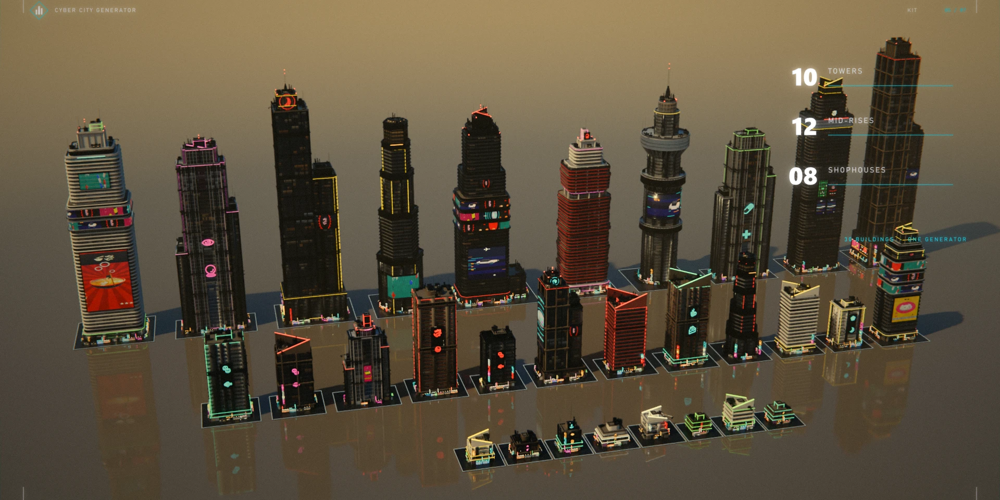 | 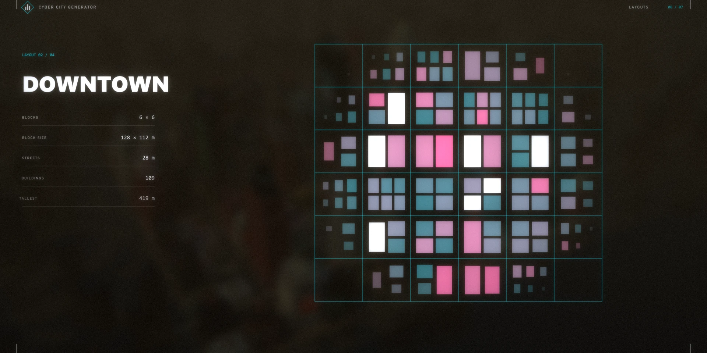 |
| 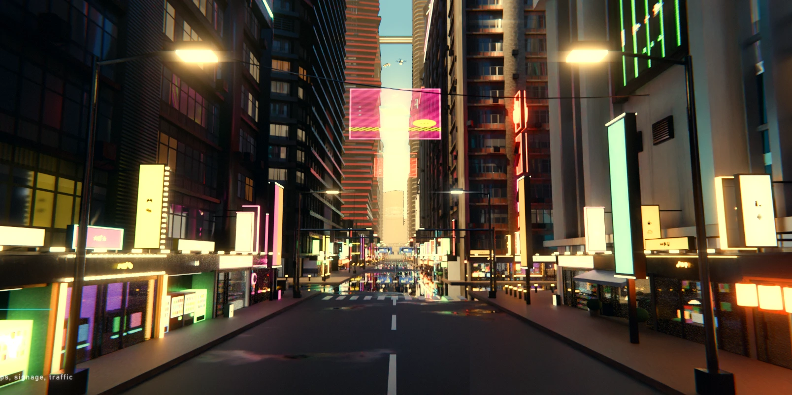 | 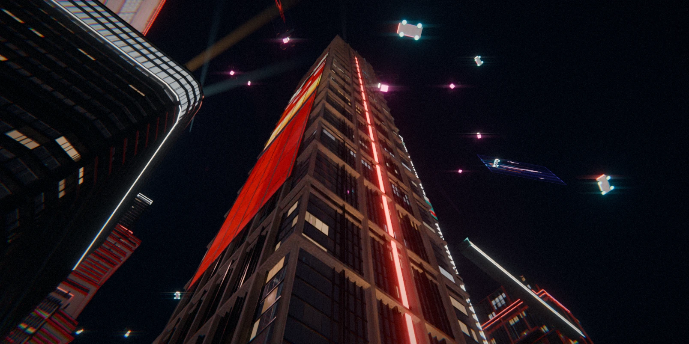 |
| 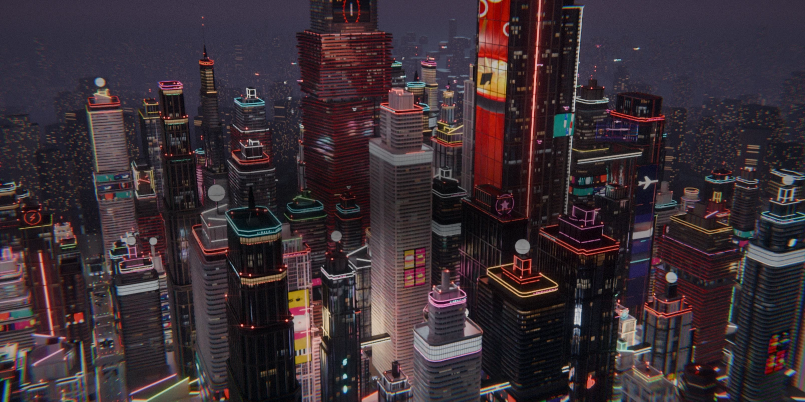 | 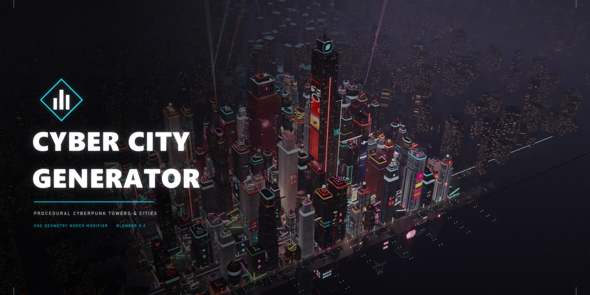 |

## What's included

- **`CyberCityGenerator.blend`:** the generator, with a demo tower in a night studio. The modifier is also an
  asset in *Add Modifier > Cyber City*. The PBR textures are embedded.
- **`CyberCity_Demo.blend`:** a prebuilt city of about 230 buildings, ready to render.
- **City builder and source:** the full Python source (GPL-3.0).
- **CC0 textures:** ambientCG PBR sets and 13 animated pictogram ad loops. There is no text and there are no
  real brands anywhere in the scene.
- **README:** every input explained, with rendering tips.

## Requirements

- Blender 5.2 or newer (tested on 5.2 LTS).
- Cycles (recommended) or Eevee.
- A full-city aerial at 1080p fits in an 8 GB GPU with the towers' LOD Distance set to about 400 m.

## Quick start

1. Unzip, open `CyberCityGenerator.blend`, select **Cyber Tower** and open *Properties > Modifiers*.
2. Change the inputs. The tower rebuilds live.
3. For a whole city:

   ```
   blender -b --python build_city.py -- --layout grid --save MyCity.blend
   ```

## License

- Scripts and generated node groups: GPL-3.0-or-later.
- Textures: CC0.
- Your renders are yours, including for commercial use.

<sub>This repository hosts the product page and media. The generator itself is available on
<a href="https://superhivemarket.com/products/cyber-city-generator">Superhive</a>.</sub>
